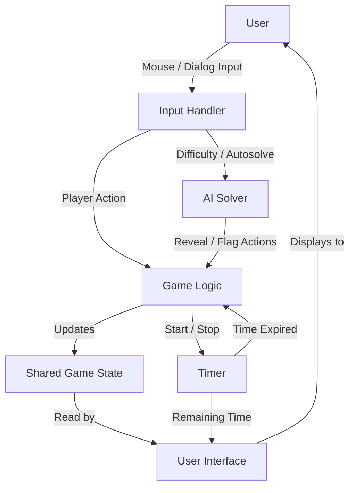
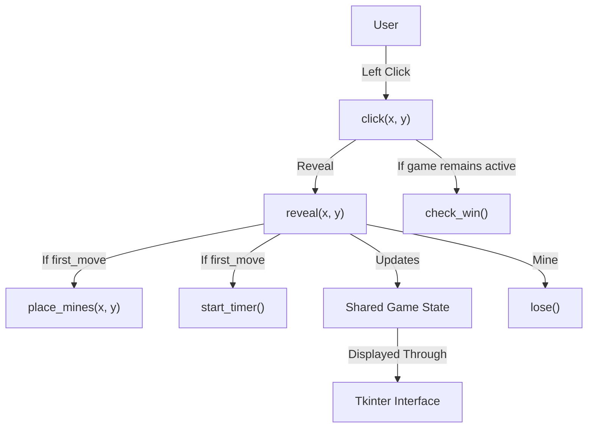
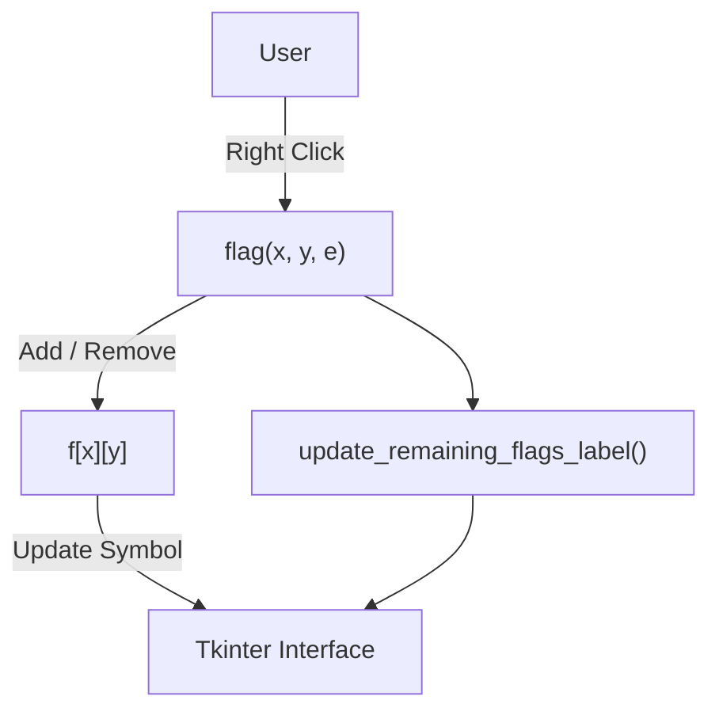
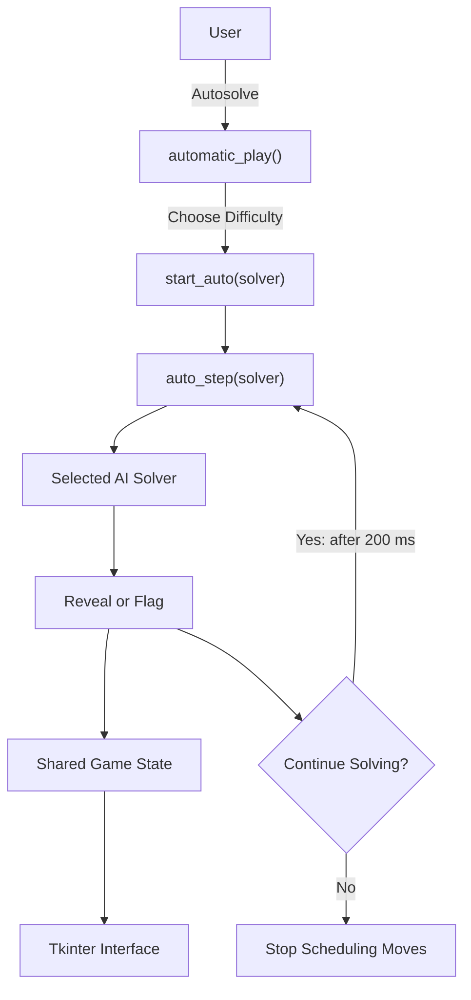
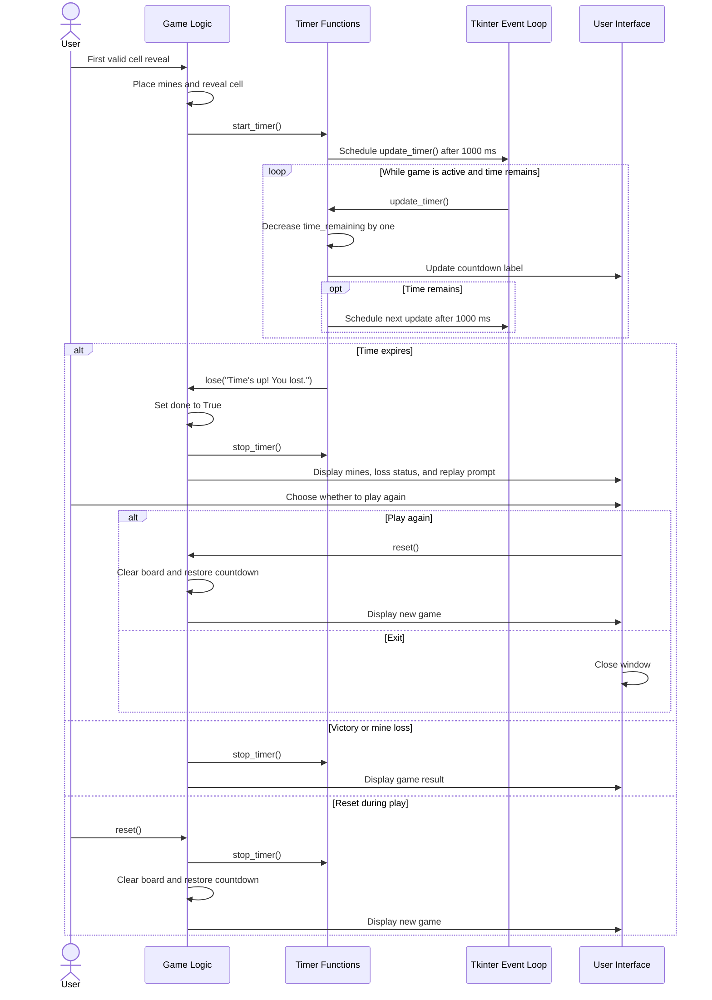

# System Architecture

This document describes the system architecture of Group 17's Project 2 Minesweeper game, inherited from Group 20. It is intended for the GTA and future teams.

[Link back to README](../README.md)

## Overview

This project is a 10x10 version of the puzzle game Minesweeper implemented in Python using Tkinter. It has a user-specified number of mines (10–20), the first selected cell and its surrounding cells are protected from mines, the user can toggle flags, and the game automatically detects a win/loss.

For Project 2, the team added Easy, Medium, and Hard AI solvers, automatic solving, and a countdown timer. The difficulty buttons perform individual AI actions on the same board, while autosolve repeatedly performs actions using the selected difficulty.

This document describes the inherited September 20 source files and Project 2 changes shown in the supplied commits through October 9, 2026. Davina also reported timer customization and a game setup dialog on October 6; those changes are not present in the supplied October 9 code. Enforced alternating player/AI turns remain a commented-out proposal in that version.

## File Layout

The inherited files are laid out as follows:

```text
.
├── .gitignore
├── README.md
├── docs
│   ├── knownIssues.md
│   ├── meetingLogs
│   ├── personHours
│   │   ├── actualPersonHours.md
│   │   └── estimatedPersonHours.md
│   └── systemArchitecture
│       └── systemArchitecture.md
├── src
│   ├── config.json
│   └── minesweeper.py
└── test
    └── .gitkeep
```

- `src` contains the game source code and configuration file.
- `minesweeper.py` contains the interface, shared state, and game logic. The supplied Project 2 changes add the timer and AI functions to this file.
- `config.json` contains rows, columns, and mine-count values. The supplied implementation does not read this file; it defines these settings directly in the source code.
- `docs` contains the inherited architecture documentation, person-hours records, meeting logs, and known issues.
- `README.md` describes the project.
- `test` contains a placeholder file in the inherited project.
- Project 2 documentation is stored in the `documentation` folder on the submitted branch.

## Components



- Board Manager: Implemented by `place_mines()` and the shared board structures.
  - Places mines and calculates adjacent mine counts.
  - Maintains matching coordinates across board values, revealed states, flags, and buttons.
- Game Logic: Implemented by `reveal()`, `click()`, `flag()`, `check_win()`, `lose()`, and `reset()`.
- User Interface: Implemented using Tkinter buttons, labels, and dialogs.
- Input Handler: Implemented by cell-button callbacks, right-click bindings, reset controls, and AI controls.
- AI Solver: Implemented by `easy_solver()`, `medium_solver()`, `medium_rules()`, `hard_solver()`, and `one_two_one_solver()`.
- Automatic Solving: Implemented by `automatic_play()`, `start_auto()`, `auto_step()`, and `stop_auto()`.
- Timer: Implemented by `start_timer()`, `update_timer()`, and `stop_timer()`.

These are logical components within a single module. They communicate through function calls and shared global variables. Several gameplay functions directly update Tkinter widgets.

For future extensions, separating board logic from interface updates would allow the AI rules and game behavior to be tested independently of the graphical interface.

## Code Structure

The main code file is:

- `src/minesweeper.py`: depends on `tkinter`, `tkinter.simpledialog`, `tkinter.messagebox`, and `random`.

### minesweeper.py

- Entry point of the program.
  - Creates the Tkinter window.
  - Sets the window title to `Minesweeper`.
  - Defines a board dimension of 10 and an initial mine count of 15.
- Creates a 10x10 matrix of cell buttons.
- Displays column labels A–J and row labels 1–10.
- Connects cell selections to `click()` and right-click actions to `flag()`.
- Creates Reset, Easy Mode, Medium Mode, Hard Mode, and Autosolve buttons.
- Displays remaining flags, mine information, game status, and remaining time.
- Calls `reset()` to initialize the game.
- Enters the Tkinter event loop using `root.mainloop()`.

### Board and Game Logic

- `place_mines(exclude_x, exclude_y)`
  - Creates a safe region containing the first selected cell and its in-bounds neighbors.
  - Clears previous board values.
  - Randomly places `M` mines outside the safe region.
  - Stores mines as `-1`.
  - Calculates adjacent mine counts for every non-mine cell.

- `reveal(x, y)`
  - Rejects out-of-bounds coordinates, revealed cells, and flagged cells.
  - Calls `place_mines()` on the first valid reveal.
  - Starts the timer after the first valid reveal.
  - Marks the selected cell as revealed.
  - Calls `lose()` if the cell contains a mine.
  - Displays the adjacent mine count for a safe cell.
  - Recursively reveals neighbors when the adjacent count is zero.

- `click(x, y)`
  - Handles a player reveal while the game is active.
  - Calls `reveal()`.
  - Calls `check_win()` if the game has not ended.

- `flag(x, y, e)`
  - Prevents flagging after the game ends or on revealed cells.
  - Prevents placing another flag when no flags remain.
  - Toggles the cell's flag state.
  - Updates the flag symbol and remaining-flags information.

- `check_win()`
  - Checks whether the number of revealed cells equals `N * N - M`.
  - Sets `done` to `True` on victory.
  - Stops the timer.
  - Displays a victory message and closes the window.

- `lose(message, exploded_cell=None)`
  - Returns if the game has already ended.
  - Sets `done` to `True`.
  - Stops the timer.
  - Displays all mines.
  - Highlights the selected mine in red when an exploded-cell coordinate is supplied.
  - Updates the status to loss.
  - Asks whether the user wants to play again.
  - Calls `reset()` or closes the window based on the response.

- `reset()`
  - Stops pending timer and autosolve callbacks.
  - Requests a mine count between 10 and 20.
  - Clears board values, revealed states, and flags.
  - Restores the cell buttons.
  - Sets `done` to `False` and `first_move` to `True`.
  - Restores the countdown duration.
  - Updates the interface.
  - Waits until the next valid reveal before placing mines.

- `calculate_remaining_flags()`
  - Returns `M` minus the number of flagged cells while the game is active.
  - Returns zero after the game ends.

- `update_remaining_flags_label()`
  - Updates the remaining-flags label.
  - Updates `mines_remaining_label` using the same remaining-flags value.

### Timer

- `start_timer()`
  - Schedules the first countdown update after one second using `root.after()`.

- `update_timer()`
  - Returns if the game has ended.
  - Subtracts one second from `time_remaining`.
  - Updates the displayed minutes and seconds.
  - Calls `lose("Time's up! You lost.")` when time reaches zero.
  - Otherwise schedules another update after one second.

- `stop_timer()`
  - Cancels the pending countdown callback using `root.after_cancel()`.
  - Clears its stored callback identifier.

The timer is the team's custom addition. It adds a time limit to the game and reuses the shared loss-handling function when time expires.

The supplied October 9 code uses a two-minute countdown. Davina's October 6 work log reports the ability to enable or disable the timer, enter a custom duration up to one hour, and configure options through a game setup dialog class. Integration of those changes is not shown in the supplied code.

### Easy AI

- `easy_solver()`
  - Creates a list of cells that are neither revealed nor flagged.
  - Selects one cell using `random.choice()`.
  - Calls `reveal()` on the selected cell.
  - Checks for victory if the game remains active.

Vrishank implemented the initial Easy solver. Alex later added flagged-cell avoidance and the victory check.

### Medium AI

- `medium_solver()`
  - Calls `medium_rules()`.
  - Falls back to `easy_solver()` when no rule applies.

- `medium_rules()`
  - Examines revealed cells with positive adjacent mine counts.
  - Collects hidden, flagged, and unflagged neighboring cells.
  - If the total hidden-neighbor count equals the revealed number, flags one unflagged neighbor.
  - If the flagged-neighbor count equals the revealed number, reveals one unflagged neighbor.
  - Returns `True` after performing an action.
  - Returns `False` if no rule applies.

Each invocation performs at most one rule-based action. Repeated invocations process additional eligible cells.

Mo and Noah reported completing Medium AI on the `Mo-Noah-MediumAI` branch. Drew later added a separate Claude-assisted Medium implementation while developing Hard AI, reporting that he had missed their updated branch. The supplied October 9 commit contains Drew's implementation.

### Hard AI

- `hard_solver()`
  - Returns if the game has ended.
  - Attempts the 1-2-1 pattern rule first.
  - Attempts the Medium rules next.
  - Falls back to Easy AI if neither produces an action.

- `one_two_one_solver()`
  - Searches for three consecutive revealed cells containing 1–2–1.
  - Checks horizontal and vertical orientations, with hidden cells on either side.
  - Requires the hidden-neighbor sets to match:
    - First revealed cell: `{p, q}`
    - Middle revealed cell: `{p, q, t}`
    - Last revealed cell: `{q, t}`
  - Identifies `p` and `t` as mines and `q` as safe.
  - Flags one outer cell or reveals the middle cell per invocation.
  - Checks for victory after a reveal.

- Helper functions:
  - `neighbors(x, y)`: returns neighboring coordinates within the board.
  - `hidden_set(x, y)`: returns hidden neighboring coordinates.
  - `in_bounds(c)`: checks whether a coordinate is inside the board.
  - `place_flag(x, y)`: places an AI flag and updates the interface.
  - `after_ai_reveal()`: checks for victory if the game remains active.

### Automatic Solving

- `automatic_play()`
  - Opens a difficulty-selection popup while the game is active.
  - Provides Easy, Medium, Hard, and Cancel controls.
  - Starts automatic solving with the selected solver.

- `start_auto(solver)`
  - Cancels an existing autosolve callback.
  - Calls `auto_step()` with the selected solver.

- `auto_step(solver)`
  - Performs one solver action.
  - Stops if the game ends or a reset restores `first_move`.
  - Checks for victory.
  - Stops if no covered, unflagged cells remain.
  - Otherwise schedules another action after 200 milliseconds.

- `stop_auto()`
  - Cancels the pending autosolve callback.
  - Clears its stored callback identifier.

The difficulty buttons allow individual AI actions, but the supplied implementation does not enforce alternating player/AI turns. `interactive_play()` remains commented out.

## Data Structures

- Shared game state:
  - `a`: 10x10 integer list storing board contents.
    - `-1`: mine.
    - `0`: no adjacent mines.
    - `1–8`: number of adjacent mines.
  - `r`: 10x10 Boolean list tracking revealed cells.
  - `f`: 10x10 Boolean list tracking flagged cells.
  - `btns`: 10x10 list of Tkinter buttons.
  - `N`: integer board dimension, set to 10.
  - `M`: integer containing the selected mine count.
  - `done`: Boolean indicating whether the game has ended.
  - `first_move`: Boolean indicating whether mines still need to be placed.

- Timer state:
  - `GAME_TIMER`: countdown duration in seconds.
  - `time_remaining`: remaining countdown seconds.
  - `timer`: pending timer callback identifier or `None`.

- Autosolve state:
  - `auto_next`: pending autosolve callback identifier or `None`.
  - `solver`: function supplied to the autosolve loop.

- AI working structures:
  - `hidden_cells`: list of covered, unflagged cells used by Easy AI.
  - `hidden`: set of hidden neighbors used by Medium AI.
  - `flagged`: list of flagged hidden neighbors.
  - `unflagged`: list of unflagged hidden neighbors.
  - `orientations`: direction pairs used to search for 1-2-1 patterns.

The board structures use matching `[x][y]` indices. In the button layout, the first index corresponds to the row and the second to the column.

## Data Flow

- Input screen:
  1. `reset()` requests a mine count from 10–20.
  2. The game clears previous board state and restores the interface.
  3. The timer display is reset.
  4. The game waits for the first valid reveal before placing mines and starting the countdown.

- Left click:
  1. The user left-clicks a cell.
  2. Tkinter calls `click(x, y)`.
  3. `click()` calls `reveal(x, y)`.
  4. On the first valid reveal, mines are placed and the timer starts.
  5. `reveal()` updates the board state and cell display.
  6. A mine triggers `lose()`; an empty cell recursively reveals neighbors.
  7. `click()` checks for victory if the game remains active.

- Right click:
  1. The user right-clicks a covered cell.
  2. Tkinter calls `flag(x, y, e)`.
  3. The function validates the action and toggles `f[x][y]`.
  4. The cell symbol and remaining-flags information are updated.

- AI action:
  1. The user selects a difficulty button.
  2. The corresponding solver selects an action.
  3. Easy AI chooses a random covered, unflagged cell.
  4. Medium AI attempts its two rules before falling back to a random reveal.
  5. Hard AI attempts the 1-2-1 pattern, then Medium rules, then a random reveal.
  6. The action updates shared state and the interface.

- Autosolve:
  1. The user selects Autosolve.
  2. `automatic_play()` displays the difficulty popup.
  3. The selection calls `start_auto(solver)`.
  4. `auto_step()` performs one action and checks the game state.
  5. Additional actions are scheduled after 200 milliseconds while solving can continue.

- Timer:
  1. The first valid reveal calls `start_timer()`.
  2. `update_timer()` subtracts one second and updates the display.
  3. Another update is scheduled while time remains.
  4. Expiration calls `lose()`.
  5. Victory, loss, or reset stops the countdown.

## Sequence Diagrams

### Left Click / Uncover



### Right Click / Flag



### AI / Autosolve



### Custom Addition / Timer UML Sequence Diagram

This UML sequence diagram describes the countdown timer shown in the supplied code. The participants represent responsibilities within `minesweeper.py`, not separate implemented classes.



## Asset Attributes

The supplied implementation uses Tkinter widgets, the Arial font, and Unicode symbols for flags and mines. No separate image or audio assets are included in the inherited ZIP.

- Original implementation:
  - Author: Pruthviraj Sadhankar.
  - Creation date: September 13, 2026.
  - Collaborators: Liam Kinghouser, Gael Salazar-Morales, Joshua Fakunmoju, Carter Ruff, and Gabriel Haro-Villa.

- External assistance attributed in the supplied source comments:
  - GitHub Copilot 1.0.85: initial mine-placement function and general guidance.
  - Claude: autosolve loop, with comments added by Alex.
  - Claude: Drew's Medium AI implementation used during Hard AI development.
  - VS Code inline suggestions: assistance with Hard AI helper functions.

Code attribution must remain in the relevant source files. File prologues must identify the module's purpose, inputs, outputs, external sources, author's full name, and creation date. Major code blocks must explain their behavior and identify original, sourced, or combined work.

## Person Hours

#### Drew Franke

| Task | Estimated | Actual |
| --- | --- | --- |
| 10/09/2026 — Claude-assisted Medium AI implementation and Hard AI solver on main | 4 | 4 |
| **Total** | **4** | **4** |

#### Vrishank Kulkarni

| Task | Estimated | Actual |
| --- | --- | --- |
| 10/02/2026 — Easy AI mode | 2 | 2.25 |
| **Total** | **2** | **2.25** |

#### Alex Lanter

| Task | Estimated | Actual |
| --- | --- | --- |
| 09/21/2026 — Reviewed inherited project, tested Project 1 requirements, and summarized findings and possible additions | Included in total | 0.75 |
| 10/03/2026 — Merged Davina's and Vrishank's work into main and activated placeholders | Included in total | 0.75 |
| 10/03/2026 — Added autosolve and supporting functions, comments, button adjustments, Easy AI updates, and testing | Included in total | 2.0 |
| **Total** | **3** | **3.5** |

#### Mo Osby

| Task | Estimated | Actual |
| --- | --- | --- |
| 10/06/2026 — Medium AI flag placement and connection of the Medium button to the solver | 2 | 2 |
| **Total** | **2** | **2** |

#### Kayaan Patel

| Task | Estimated | Actual |
| --- | --- | --- |
| 10/10/2026 — System architecture documentation and UML diagrams | 2 | 2.5 |
| **Total** | **2** | **2.5** |

#### Davina Love

| Task | Estimated | Actual |
| --- | --- | --- |
| 09/26/2026 — Timer implementation, separation of loss handling into its own function, and comments | Included in total | 4 |
| 10/06/2026 — Timer customization, game setup dialog class, and README updates for timer changes | Included in total | 2 |
| **Total** | **2** | **5** |

#### Noah Mast

| Task | Estimated | Actual |
| --- | --- | --- |
| 10/06/2026 — Medium AI reveal rule when flagged neighbors equal the adjacent mine count | 2 | 2 |
| **Total** | **2** | **2** |

#### How we got our estimates:

We made informal estimates based on how difficult we expected each member's assigned work to be and how long we thought implementation, documentation, and testing would take. These were rough guesses rather than estimates calculated using a formal model. Estimates were recorded as totals for each member's work; separate task estimates were not available for members with multiple entries.

Actual hours were collected from team members' work reports in the Discord chat. Each report identified the work completed and the time spent. EECS 581 lecture time is excluded.

#### Group Meetings: Approximately 2–3 hours of meeting duration

The team reports approximately 2–3 hours of meetings. Exact dates, durations, and individual attendance have not been confirmed. This duration is not added to the person-hours total because meeting person-hours must account for each attendee's time.

#### Group Meeting Estimate: Approximately 2–3 hours of meeting duration

## Grand Total Person Hours

### Estimated Work Hours = 12
### Actual Reported Work Hours = 16.25

These totals exclude meeting person-hours, which must be added once individual attendance and durations are confirmed.
